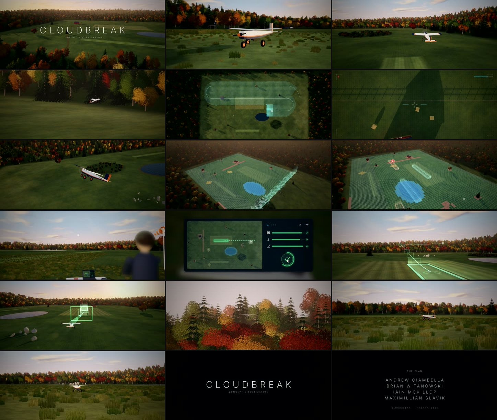

# Cloudbreak concept film

A 2:15 synthetic, cinematic demo of the full Cloudbreak mission, built entirely from code:
takeoff → survey scan → onboard classification → landing-strip selection → pilot approval on the laptop →
guided approach → autonomous touchdown → end credits. 1080p, 2.39:1 letterbox, 24 fps, original score and sound design.



The rendered video isn't in git (the master is ~375 MB and the share copy ~120 MB, both over GitHub's 100 MB limit).
Rebuild it with the steps below, or ask Andrew for the file.

## Quick start

```bash
pip install numpy scipy pillow matplotlib playwright
python -m playwright install chromium
# also needed on PATH: Node.js/npm and ffmpeg (with ffprobe)

./make_film.sh            # Git Bash on Windows; resumable, re-run to continue after an interruption
```

Outputs land in `out/`:

| File | What |
|---|---|
| `Cloudbreak_Concept_Film.mp4` | Master: x264 crf 18 with AAC 256k |
| `Cloudbreak_Concept_Film_web.mp4` | Share copy: crf 21, capped at 9 Mb/s |
| `shot_XX_<id>.mp4` | Per-shot renders (resumable cache) |

## Pipeline

| Step | Script | Produces |
|---|---|---|
| 1 | `path.py` | `web/mission.json`: the flight at 60 Hz (taxi, climb, lawnmower survey, loiter, spiral descent, final, flare, rollout), with attitude, throttle and rpm |
| 2 | `assets.py` | `web/world.json`, `ground.jpg`, `detail.png`: field layout, heightmap, 4,000 trees, class grid (usable / obstacle / people / water / unknown), scan times |
| 3 | `web/` (three.js r170) | The scene: `world.js` (terrain, sky, props), `real.js` (leaf-card trees, grass, water, people, plane), `film.js` (shots, overlays, laptop UI, compositor, letterbox, lens flare) |
| 4 | `render.py` | Drives headless Chrome through Playwright. Each frame is a deterministic `FILM.frame(t)`, piped to ffmpeg one file per shot. Also writes `out/cues.json` and `out/meta.json` |
| 5 | `credits_render.py`, `audio.py` | End-credits card (`web/credits.html`). Soundtrack synthesized in numpy from the cues: pads and arpeggio score, motor tied to rpm/throttle with distance and Doppler, wind, ground roll, touchdown, UI clicks and chimes, birds |
| 6 | `assemble.sh` | Concat, grade (bloom, colour balance, vignette, grain on the active area only), mux, and the share copy |

Review tools:
- `python still.py stills/x @touchdown:0.56 @pilot:0.2` renders single frames, by film time or `@shot:fraction`.
- `python bench.py establish final` prints seconds per frame.

## Changing things

- **Shots and timing:** the `add('<id>', <seconds>, (lt) => {...})` list in `web/film.js`. Each shot returns its camera, fov, overlays and UI state for local time `lt`.
- **Credits:** `NAMES` in `web/credits.html`. If you change the card length (`DUR`), also update `TAIL` in `audio.py`.
- **Music:** the `CH` chord table and the `SECT` arpeggio sections in `audio.py`.
- **Look:** the `GR` filter chain in `assemble.sh`, and `FILMQS` (`?rs=0.8333` renders at 83% scale; `?rs=1` is full resolution and about 25% slower).
- **Speed:** `FILM_GPU=1` uses your GPU instead of SwiftShader. On a 2-core CPU the full render takes about 2.5–3 h. `FPS=6 python render.py <shot>` gives a quick draft of one shot.

## Credits

Built for HackRPI 2026 by Andrew Ciambella, Brian Witanowski, Iain McKillop and Maximillian Slavik.
`web/grasslight-big.jpg` and `web/waternormals.jpg` are from the three.js examples (MIT). Everything else is generated procedurally.
