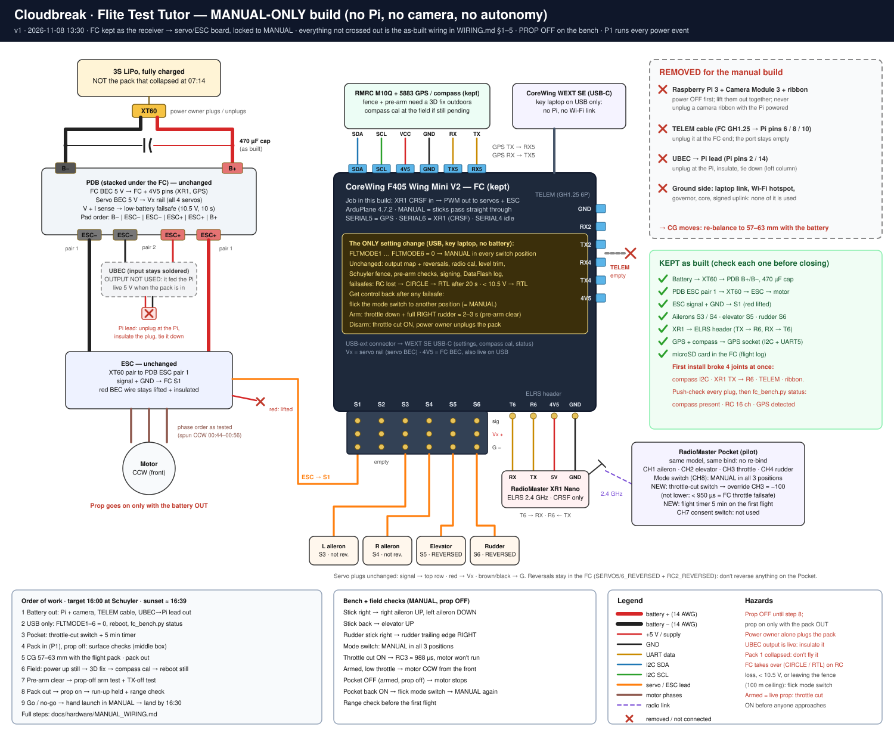

# Tutor manual-only build

**v1 · 2026-11-08 13:30 · Target: flying at Schuyler by 16:00 (sunset ≈ 16:39).** To regenerate the diagram, run `python docs/hardware/manual_wiring_svg.py docs/hardware/manual_wiring.svg`.

**What this build is.** The plane is flown with the sticks only. No Pi, no camera, no governor and no missions. The XR1 Nano has only a serial (CRSF) output and can't drive servos by itself, so the FC stays in. Its job now is to turn the receiver's channels into servo and ESC signals, and it is locked to **MANUAL**: the sticks pass straight through to the surfaces and the motor. Almost nothing is rewired. Three things come out, and one group of settings changes. Everything else is the as-built wiring in [`WIRING.md`](WIRING.md) §1–5.

> ⚠️ **Settle these before anyone starts**
> - `AGENTS.md` and `STATUS.md` make **Sunday 11:00 the hard end for flying**, so a 16:00 flight is outside the plan. The team and P1 (**Andrew**, deputy power marshal since Iain retired) need to agree to it first. It isn't a Cloudbreak flight gate, so don't record it in `config/flight_gates.toml`.
> - **P1 (Andrew) runs every power event.** Only the power owner plugs the pack in or out. The prop stays off for all bench work.
> - **Andrew now holds P1, the key laptop and the airframe.** If he is also the power owner at the field, the **pilot and the safety observer must be two other people**.
> - **The safety layer isn't weakened.** The fence, pre-arm checks, signing, failsafes and the flight log all stay as audited. The only change is which mode the switch selects.

**Bring:**
- The key-holding laptop (Andrew's). The FC is signed, so settings go through the repo scripts or `scripts\mission_planner_signed.bat`.
- The FC's USB-C cable.
- A **fully charged, healthy pack**. Not pack 1, which collapsed at 07:14.
- The prop and its nut, a wrench, a meter, tape or heat-shrink, zip ties, and the Pocket, charged.

| By | Step |
|---|---|
| 13:45 | §1: take out the Pi, camera, TELEM cable and UBEC lead |
| 14:15 | §3: FC settings · §4: Pocket |
| 14:45 | §5: bench checks + CG |
| 15:00 | Leave for Schuyler |
| 15:15–15:55 | §6: steps 1–9 at the field |
| 16:00 | Fly. Land by 16:30 |

## 1 · Take out (battery OUT, FC unpowered)

| Item | How |
|---|---|
| Raspberry Pi 3 + Camera Module 3 + ribbon | Lift them out together. Never unplug a camera ribbon while the Pi is powered: that's how the Zero's camera port died |
| TELEM cable | Unplug the GH1.25 plug at the FC's TELEM port. The port stays empty |
| UBEC → Pi lead | Unplug it from Pi pins 2 and 14, **insulate the plug** (heat-shrink or tape) and tie it down. The UBEC input stays soldered to PDB pair 2, so this plug has 5 V on it whenever the pack is in. Don't desolder anything |

The CG moves once these are out. Re-balance in §5.

## 2 · Stays as built: push-check every plug

| Connection | Ref |
|---|---|
| Battery XT60 → PDB B+ / B−, with the 470 µF capacitor across them | WIRING §1 |
| PDB ESC pair 1 → XT60 → ESC → motor (spins CCW seen from the front) | §1, §2 |
| ESC signal + GND → **S1**. The ESC's red (BEC) wire stays **lifted and insulated** | §2 |
| S3 left aileron · S4 right aileron · S5 elevator · S6 rudder · S2 empty | §3 |
| XR1: TX → **R6**, RX → **T6**, 5V → 4V5, GND → GND | §4 |
| GPS + compass → GPS socket (SDA, SCL, 4V5, GND, TX5, RX5). **It stays in:** the fence and the pre-arm checks need a 3D fix | §5 |
| microSD card in the FC (flight log) | — |

The first install broke four connections at once: the compass I2C, XR1 TX → R6, TELEM, and the camera ribbon. Push every plug home before you close the hatch, then confirm with §3 step 4.

## 3 · FC settings (USB only, no battery)

1. **Backup:** `.venv\Scripts\python scripts\fc_setup_usb.py --port COMx`. This is a dry run: it saves a full parameter backup and should report 0 changes.
2. **Set the modes:**
   - Run `scripts\mission_planner_signed.bat`. In Mission Planner pick **UDP**, then **Connect**, port **14550**. Never pick the COM port.
   - Open **Config → Full Parameter List** and set **`FLTMODE1` … `FLTMODE6` = 0** (MANUAL).
   - **Write Params**, then **Refresh Params** and check all six read 0.
   - Close Mission Planner and the proxy window.
   - The old values: FLTMODE1 5 (FBWA) · 2 11 (RTL) · 3 5 · 4 10 (AUTO) · 5 0 · 6 11.
3. **Reboot the FC:** unplug and replug the USB.
4. **Check:** `.venv\Scripts\python scripts\fc_bench.py status --port COMx`. It must show:
   - compass QMC5883L present, RC 16 channels, GPS detected;
   - the output map OK, with S1 at 1100 µs;
   - mode **MANUAL** with the switch in **each** of its three positions.

   Indoors, the pre-arm still lists the GPS fix, the compass and the fence position. That's expected until the field.

**Nothing else changes.** These all stay as audited:
- the output map and reversals (`SERVO5_REVERSED`, `SERVO6_REVERSED`, `RC2_REVERSED`), radio calibration and level trim;
- the Schuyler fence (21 vertices, 100 m ceiling, breach → RTL), pre-arm checks, signing and DataFlash logging;
- the failsafes:
  - RC lost → CIRCLE, then RTL after 20 s;
  - below 10.5 V for 10 s → RTL.

Those failsafes and a fence breach are the only times the FC flies the plane by itself. **To take control back, flick the mode switch to another position.** Every position is MANUAL now.

*Pilot's option:* for a self-levelling "panic" position, set `FLTMODE6 = 5` (FBWA, switch high) instead. FBWA directions were verified at 04:20.

## 4 · Pocket (radio)

- **Keep the same model and the same bind.** Don't rebind and don't reverse any channel on the Pocket: the reversals live in the FC.
- **Add a throttle cut:**
  - Go to MODEL → SPECIAL FUNCTIONS, pick a free 2-position switch, and set it to **Override CH3 = −100**, enabled.
  - Use exactly −100. Anything below 950 µs is a throttle failsafe on the FC (`THR_FS_VALUE` 950).
- **Add a timer:** a 5-minute countdown that starts with the throttle, for the first flight.
- **Leave CH8 and CH7 as they are.** Every CH8 (mode switch) position is MANUAL now, and CH7 (consent) does nothing.

## 5 · Bench checks (pack in by P1 = Andrew, PROP OFF)

| Check | Expected |
|---|---|
| Aileron stick right | Right aileron UP, left aileron DOWN |
| Elevator stick back | Elevator UP |
| Rudder stick right | Rudder trailing edge RIGHT |
| Mode switch, all three positions | Still MANUAL: the surfaces keep following the sticks |
| Throttle cut ON | CH3 ≈ 988 µs in `fc_bench.py rc`. With the cut OFF, it follows the stick |
| Throws | Set to the FT Tutor build guide. Measure them and write them down (never measured yet) |
| **CG** | **57–63 mm behind the leading edge**, with the flight pack in. Slide the pack to get there; add nose weight only if the pack can't |

Then the pack comes out. You can't test the motor indoors: the FC won't arm without a GPS fix inside the fence.

## 6 · At Schuyler

1. **Power up.** The power owner plugs the pack in, and the plane stays **still** for at least 10 s (gyros).
2. **GPS fix.** Wait for a 3D fix outdoors under open sky.
3. **Compass calibration**, if it hasn't been done since 07:49 (the pre-arm says `Compass not calibrated`):
   - Laptop on USB: `fc_bench.py compass --accept --port COMx`.
   - Turn the plane through every axis, away from cars and steel.
   - Then **reboot with the plane still**.
4. **Pre-arm clear.** `fc_bench.py status --port COMx` shows no `PreArm:` lines. Then unplug the USB.
5. **Arm test, PROP OFF:**
   - Throttle cut OFF, throttle down, full right rudder for about 2–3 s → armed. If the first arm is refused with `Logging not started`, wait a few seconds and retry.
   - A little throttle → the motor turns CCW seen from the front.
   - **Switch the Pocket off.** The FC goes to CIRCLE and the motor must stop: it holds the throttle at zero until it detects flight. **If the motor keeps running, don't fly.**
   - Pocket back on → flick the mode switch → MANUAL.
   - Throttle cut ON → the power owner unplugs.
6. **Range check (disarmed, pack in, prop off):**
   - In the ELRS Lua script, set TX power to its lowest setting.
   - Walk 30–50 m away. The observer checks that the surfaces follow every stick smoothly.
   - Set the power back.
   - Any stutter means no flight. The FC's built-in Wi-Fi was suspected of short dropouts overnight.
7. **Prop on.** Pack **out** → prop on (lettered side forward) → pack in → plane still → arm.
8. **Run-up.** Someone holds the plane firmly from behind, nobody in front: full throttle for 5 s. The surfaces stay responsive and nothing resets.
9. **Go / no-go.** Any "no" means no flight:
   - wind ≤ 5 m/s sustained, gusts checked;
   - field clear;
   - pilot, safety observer and power owner named: three different people;
   - pack full, CG checked;
   - you can land by 16:30.
10. **Fly:**
    - Hand launch in MANUAL at full throttle, wings level, slightly nose up. Climb and trim on the Pocket.
    - Stay **inside the Schuyler fence and below 100 m**, or the FC switches to RTL. Flick the mode switch to take back control.
    - Land when the timer goes off.
    - After landing: throttle cut ON, then the power owner unplugs.

## 7 · Back to the Cloudbreak build later

- **FC:**
  - In Mission Planner (through the proxy), set the modes back: `FLTMODE1` 5, `FLTMODE2` 11, `FLTMODE3` 5, `FLTMODE4` 10, `FLTMODE5` 0, `FLTMODE6` 11.
  - Then the `fc_setup_usb.py --port COMx` dry run must show 0 changes.
- **Hardware:**
  - Put the Pi 3 back on TELEM (pins 6/8/10) and the UBEC (pins 2/14), per WIRING §1 and §6. Fit the camera ribbon with the power off.
  - Then repeat the G4 check, and run `fc_params_pi.py audit --site schuyler`: it must show 0 differences.
