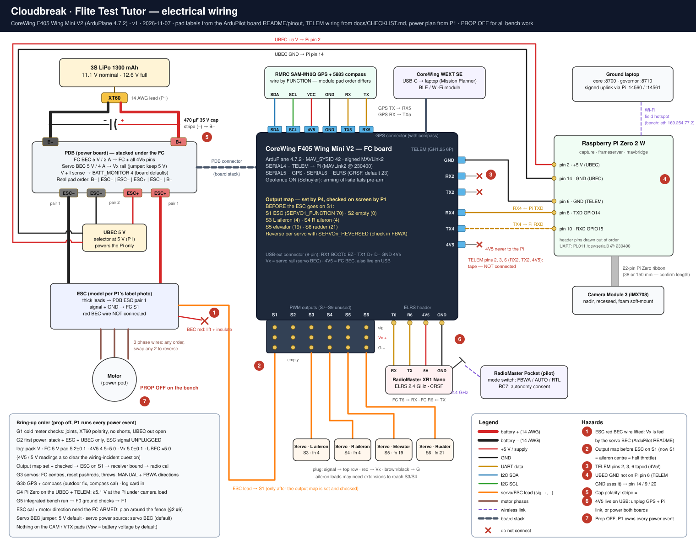

# Tutor electrical wiring

**v1.1 · 2026-11-07 18:45.** Per-person checklists: [`docs/WORKPLAN.md`](../WORKPLAN.md). This page lists every connection on the plane in one place. It's the reference for the hardware gates G1–G5 and for F0.

**Sources:**
- Pad labels: the ArduPilot [CoreWingF405WMiniV2 board README](https://github.com/ArduPilot/ardupilot/blob/Plane-4.7.2/libraries/AP_HAL_ChibiOS/hwdef/CoreWingF405WMiniV2/README.md) and its pinout images (Plane-4.7.2)
- TELEM wiring: `docs/CHECKLIST.md`
- Power plan, output map and G2 readings: P1's updates in `docs/updates/`

Anything marked ⬜ is still a P1/P4 decision in `STATUS.md` §5. **Prop off for every bench session. P1 (power marshal) runs every power event.**

To regenerate the diagram, edit `docs/hardware/wiring_svg.py`, then run `python docs/hardware/wiring_svg.py docs/hardware/wiring.svg`.

## 1 · Power

| From | To | Wire | Notes |
|---|---|---|---|
| Battery XT60 + | PDB **B+** | 14 AWG red (P1-made lead) | Polarity matched to the XT60 housing marks |
| Battery XT60 − | PDB **B−** | 14 AWG black | B+ and B− are at opposite ends of the PDB edge |
| 470 µF 35 V capacitor | Across B+ / B− with short twisted 22 AWG leads, **or** across the two middle ESC pads after a continuity check | — | ⬜ Location is P1's decision. Stripe (−) to negative; insulate both legs; glue the body down |
| ESC thick + / − | PDB **ESC+ / ESC−** (pair 1) | ESC leads | Don't cut the + lead short |
| UBEC input + / − | PDB **ESC+ / ESC−** (pair 2) | — | UBEC output stays disconnected until G4 |
| UBEC output +5 V | Pi **pin 2** (or pin 4) | — | GPIO 5 V has no reverse-polarity protection. Meter it before plugging in |
| UBEC output GND | Pi **pin 14** (or 9 / 20) | — | ⚠️ **Not pin 6**: the proven TELEM ground already uses pin 6 (P1's draft lead had pin 6) |

The physical pad order on the PDB edge is `B− | ESC− | ESC− | ESC+ | ESC+ | B+`. The diagram draws the B pads and the ESC pads on different edges for clarity.

**PDB jumpers:**
- Servo BEC voltage: **5 V** (default).
- Servo-rail source: **servo BEC** (default).
- VTX SW: nothing uses it.
- Don't connect anything to the CAM / VTX pads: Vsw is battery voltage by default.

## 2 · Motor and ESC

| From | To | Notes |
|---|---|---|
| ESC phase wires A / B / C | Motor's 3 wires (bullets, heat-shrink) | Any order. If it spins backwards, swap any two |
| ESC signal (white/yellow) | FC **S1** signal row | Only after `SERVO1_FUNCTION=70` is set **and P1 has checked it on screen**. Right now S1 is the aileron default, and a centred aileron signal could mean ≈ half throttle |
| ESC ground (black/brown) | FC **S1** G row | — |
| ESC red (BEC) | **Not connected**: lift the contact out of the plug and insulate it | The Vx rail is fed by the PDB servo BEC. The ArduPilot README warns not to put an ESC BEC on the servo rail |

## 3 · Servos (output map)

| Output | Device | `SERVOn_FUNCTION` |
|---|---|---|
| S1 | ESC | 70 (throttle) |
| S2 | **empty** | 0. S1 and S2 share PWM group 1 with the ESC, so keep servos off it |
| S3 | Left aileron | 4 |
| S4 | Right aileron | 4 |
| S5 | Elevator | 19 |
| S6 | Rudder | 21 |

- **Plug orientation:** signal → top row (`S#`), red → `Vx`, brown/black → `G`.
- The aileron leads may need extensions to reach S3/S4.
- Fix any reversed surface with `SERVOn_REVERSED`, and check it in **FBWA**, not only MANUAL (see §9).

## 4 · Receiver (ELRS)

| XR1 Nano | FC ELRS header (`T6 R6 4V5 GND`) |
|---|---|
| RX | **T6** |
| TX | **R6** |
| 5V | **4V5** (⬜ P1: if ≥ 4.5 V under battery at G2) |
| GND | **GND** |

`SERIAL6_PROTOCOL = 23` (serial RC) is already the board default. The 4V5 pins are also powered over USB, which makes binding on USB easy.

## 5 · GPS + compass

| RMRC SAM-M10Q + 5883 | FC GPS connector (`SDA SCL 4V5 GND TX5 RX5`) |
|---|---|
| TX | **RX5** |
| RX | **TX5** |
| VCC (5 V) | **4V5** ⬜ *or UBEC 5 V*. P1 decides at G2: 4V5 if it measures ≥ 4.75 V under battery (RMRC rates the module at 5.0 V), otherwise the UBEC (`STATUS.md` §5) |
| GND | **GND** |
| SCL | **SCL** |
| SDA | **SDA** |

- Build the harness **by function**, not by position or colour. The module's pad order differs, and so does the FC's no-compass GPS pad row (`4V5 G T5 R5`).
- Check continuity on every conductor (P1's plan).
- Mount it on top, with a clear sky view, away from the ESC, battery leads and motor.

## 6 · Pi link (TELEM = UART4 = SERIAL4)

| FC TELEM (GH1.25 6P) | Pi Zero 2 W header |
|---|---|
| pin 1 GND | **pin 6** (GND) |
| pin 2 RX2 | nothing (tape) |
| pin 3 TX2 | nothing (tape) |
| pin 4 RX4 | **pin 8** (GPIO14 TXD) |
| pin 5 TX4 | **pin 10** (GPIO15 RXD) |
| pin 6 4V5 | **nothing (tape)**. The Pi has its own UBEC |

This link is already proven at 230400: FC→Pi at 17:14 and signed HITL at 17:33. Keep the same pins when moving to the Zero 2 W.

## 7 · Camera

Camera Module 3 → Pi Zero CSI port through the **22-pin Pi Zero ribbon**. The standard 15-pin cable doesn't fit the Zero. ⬜ P3: confirm the ribbon length (≈38 or ≈150 mm), which sets where the Pi sits relative to the camera opening.

Mount the camera pointing straight down (nadir), recessed so a hard landing can't hit it, on a foam soft-mount against rolling-shutter jello.

## 8 · Wireless and other links

- **Pilot link:** RadioMaster Pocket → XR1 Nano over ELRS 2.4 GHz.
  - Flight-mode switch: FBWA / AUTO / RTL.
  - RC7: autonomy-consent switch (`docs/FLIGHT_CARDS.md`).
- **Ground link:** Pi ↔ laptop over Wi-Fi.
  - At the field, the Zero joins the hotspot. On the bench it's Ethernet at 169.254.77.2.
  - The governor uses TCP 14560 (signed); core uses 14561 (read-only).
- **Setup link:** the CoreWing WEXT SE on the USB-extender connector provides USB-C (and BLE/Wi-Fi) for Mission Planner.

## 9 · Readings to log at G2 (P1)

| Rail | Expected |
|---|---|
| Pack | record (3S: 12.6 V full) |
| FC 5 V pad | 5.2 ± 0.1 V |
| 4V5 | 4.5–5.0 V |
| Vx servo rail | 5.0 ± 0.1 V |
| UBEC output | ≈ 5.0 V. Then at G4, at the Pi pins with the camera running: ⬜ proposed pass = `get_throttled` 0x0 and ≥ 4.9 V. The UBEC's 5.0 V setting can't reliably give ≥ 5.1 V, and 6 V is too high for the Pi (`STATUS.md` §5) |
| Anything warm at 60 s? | no |

The 4V5 and 5 V readings also settle the wiring-incident question: the FC reports `Vcc = 0` over MAVLink.

## 10 · Remaining steps on the plane, with guides

| Step | Gate | Who | Guide |
|---|---|---|---|
| Power-board soldering, then cold meter checks | G1 | P1 | P1's M1.C list (`docs/updates/P1_2026-11-07_1711_M1B.md`); [board README: PDB](https://github.com/ArduPilot/ardupilot/blob/Plane-4.7.2/libraries/AP_HAL_ChibiOS/hwdef/CoreWingF405WMiniV2/README.md) |
| First power and readings | G2 | P1 | §9 above |
| Output map set and checked on screen | G3 | P4 + P1 | §3 above |
| Bind the XR1 to the Pocket | G3 | P4 | [ExpressLRS binding](https://www.expresslrs.org/quick-start/binding/) · [RadioMaster: bind ELRS to EdgeTX](https://radiomasterrc.freshdesk.com/support/solutions/articles/64000308598-how-to-bind-an-expresslrs) · [Flite Test: ELRS updating + binding](https://flitetest.com/articles/expresslrs-firmware-updating-and-binding) |
| Receiver protocol, then radio calibration | G3 | P4 | [ArduPilot: RC systems](https://ardupilot.org/plane/docs/common-rc-systems.html) |
| Accelerometer calibration (can't be done armed) | G3 | P4 | [ArduPilot: accelerometer calibration](https://ardupilot.org/plane/docs/common-accelerometer-calibration.html) |
| Servo functions, reversal (checked in FBWA), trims | G3 | P2 + P4 | [ArduPilot: four-channel planes](https://ardupilot.org/plane/docs/guide-four-channel-plane.html) |
| ESC calibration + motor direction, **prop off** | G3 | P4 + P1 | [ArduPilot: ESC calibration (Plane)](https://ardupilot.org/plane/docs/common-esc-calibration.html). ⚠️ This method **arms the FC**, and the FC can't arm at the bench (fence + no GPS indoors). Use a servo tester, or the outdoor G3b slot (`STATUS.md` §2 #6) |
| Compass calibration (outdoors, away from steel) | G3b | P1 + P4 | [ArduPilot: compass calibration](https://ardupilot.org/copter/docs/common-compass-calibration-in-mission-planner.html) |
| Balance at 57–63 mm behind the leading edge | F0 | P2 | [FT Tutor MKR2 page (full build playlist)](https://store.flitetest.com/ft-tutor-mkr2) · [FT Tutor (1055 mm) plans](https://ftca.flitetest.com/?p=8472) |
| FBWA hand check before every flight | F0 / F1 | Pilot | [ArduPilot: starting up and calibrating Plane](https://ardupilot.org/plane/docs/starting-up-and-calibrating-arduplane.html) |
| Hand launch in FBWA | F1 | Pilot | [ArduPilot: takeoff (hand launch)](https://ardupilot.org/plane/docs/takeoff-landingpage.html) · `docs/FLIGHT_CARDS.md` |
